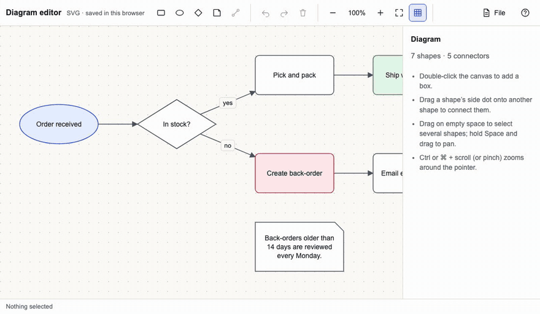
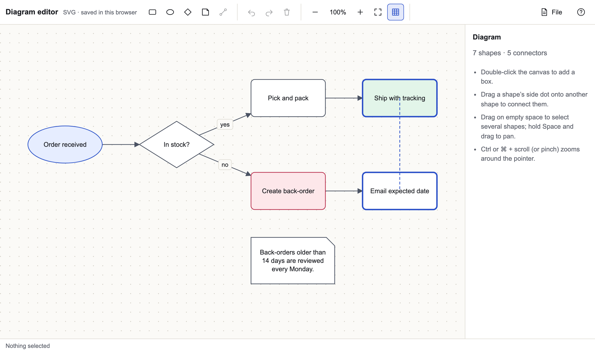
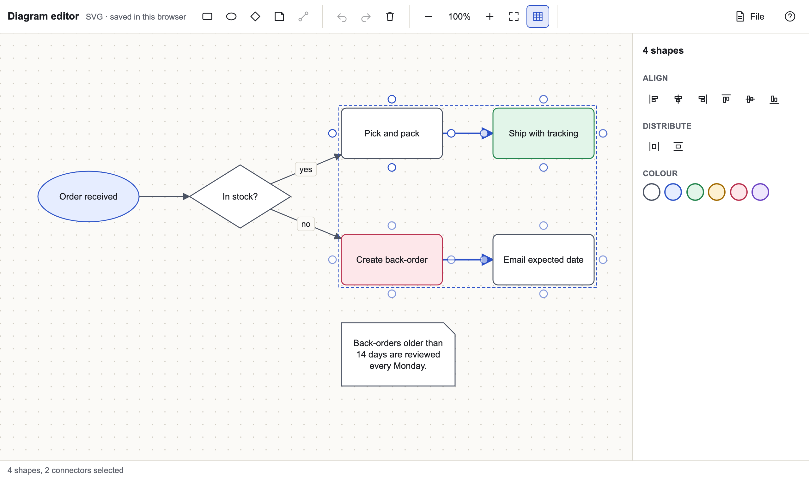
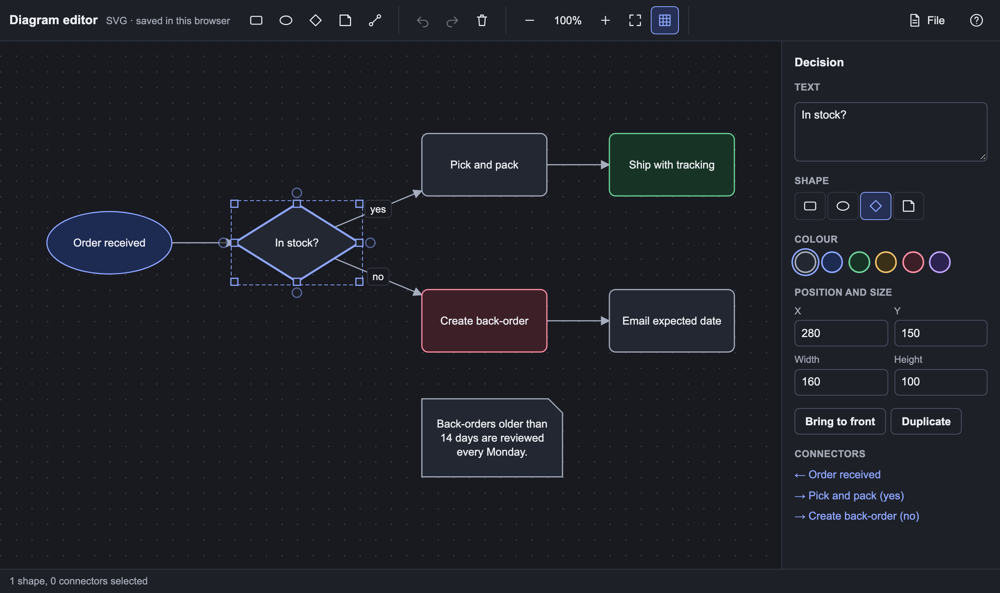
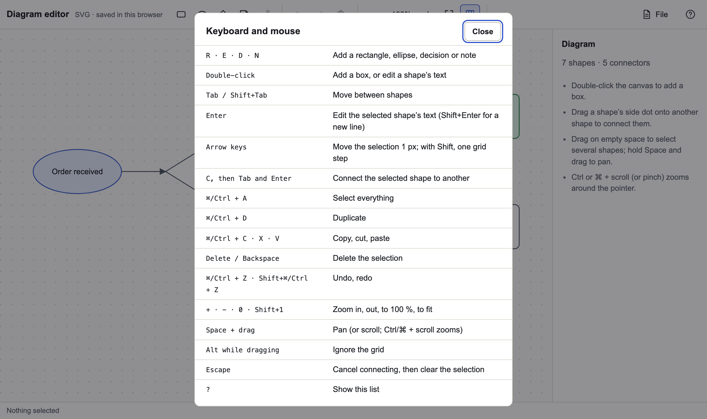
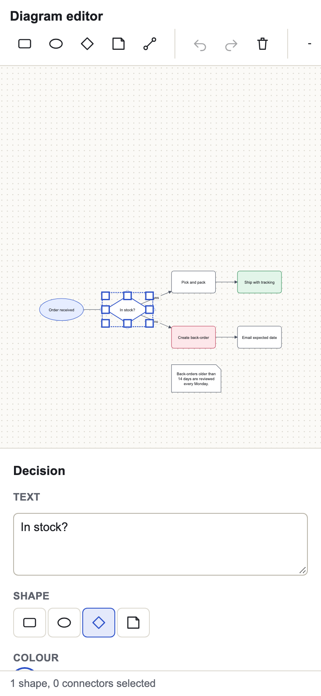

# Diagram editor

A flowchart editor built directly on SVG with React and TypeScript, with no canvas or diagramming library. Shapes, connectors, pan and zoom, selection, resizing, undo history, export and import are all implemented in this repository, and everything can be done from the keyboard.

**Live demo:** https://nada-hanad.github.io/diagram-editor/ (diagrams are saved in your browser only)



*Recorded from the deployed app with Playwright: move a shape, drag from a side dot to connect, Ctrl + scroll to zoom around the pointer, double-click to edit, Shift+1 to fit.*

## Features

- **Shapes:** rectangle, ellipse, decision (diamond) and note, with word-wrapped text, six colours and light/dark themes.
- **Connectors** start and end on each shape's real outline (rectangle, ellipse or diamond), not on its bounding box, follow their shapes when moved, and can carry a label. Duplicate and self-connections are refused with a message.
- **Navigation:** pan with Space + drag, the middle button or scrolling; zoom with Ctrl/⌘ + scroll or a pinch, keeping the point under the pointer fixed; fit to content; reset to 100 %.
- **Selection:** click, Shift-click, marquee drag, select all; multi-shape alignment (six ways) and even distribution.
- **Editing:** drag to move with grid snapping (Alt overrides), eight resize handles (Shift keeps the ratio), double-click to edit text in place, duplicate, copy/cut/paste, bring to front, numeric position and size in the inspector.
- **Undo/redo** with coalescing: a drag is one step however many pointer events it produced, and a burst of arrow-key nudges is one step.
- **Keyboard:** Tab moves between shapes (focus selects), arrows nudge, Enter edits, C then Tab and Enter connects two shapes, Delete removes, and `?` lists every shortcut. Actions are announced through a live region.
- **Files:** export SVG, PNG (2×) and JSON; import JSON with validation that names the exact problem ("Connector 3 points to a shape that does not exist"). Import is an undoable step. Autosave to `localStorage`.

| Connecting by dragging from a side dot | Marquee selection with alignment tools |
|---|---|
|  |  |

| Dark theme, shape selected | Keyboard and mouse reference |
|---|---|
|  |  |



## How it is built

React 19, TypeScript in strict mode, Vite. No state library and no diagramming or canvas library.

```
src/model/       pure, framework-free logic, unit-tested
  geometry.ts    coordinate transforms, zoom about a point, fit, outline intersection, resize
  doc.ts         document operations, alignment, distribution, import validation
  history.ts     undo/redo with keyed coalescing
  render.ts      shape geometry and text wrapping shared by the canvas and the exporter
  export.ts      standalone SVG, PNG rasterisation, downloads
src/editor/      useEditor (state and actions), keyboard shortcuts, context
src/components/  Canvas (pointer state machine), shapes, toolbar, inspector, text overlay
```

Notes on the parts that took the most care:

- **One geometry, two renderers.** `render.ts` describes each shape once. The React canvas and the SVG exporter both read it, so an export cannot drift from what is on screen. Text wrapping measures real glyph widths with a canvas context, and falls back to an average width in tests.
- **Outline intersection.** A connector aims from one shape's centre to the other's and is clipped where that ray leaves each outline. For an ellipse the scale is `1/√(dx²/a² + dy²/b²)`, for a diamond `1/(|dx|/a + |dy|/b)`, and for a rectangle whichever side is hit first.
- **Zoom about the pointer.** `zoomAt` converts the anchor to world space, changes the scale, then solves for the offset that puts the same world point back under the anchor. Tested as an invariant, not with fixed numbers.
- **Pointer handling** is a small state machine (move, resize, marquee, connect, pan, pinch) held in a ref, so pointer moves do not re-render the toolbar. Pointer capture starts only once a drag is under way: capturing on `pointerdown` retargets the following `dblclick` to the `<svg>`, which would break double-click editing.
- **Drags without drift.** A move computes every position from the shape's position at the start of the drag plus the pointer delta, never by adding up per-event deltas, and snapping applies to the grabbed shape so a multi-selection keeps its spacing.
- **Selection derived during render.** Ids that no longer exist after undo, delete or import are filtered out while rendering, not cleaned up in an effect, so no render ever sees a stale selection.

## Getting started

Requires Node 24 (see `.nvmrc`).

```bash
npm ci
npm run dev                         # http://localhost:5173

npm test                            # 35 unit tests (Vitest)
npx playwright install chromium
npm run build && npm run test:e2e   # 14 browser tests against the production build
npm run verify                      # typecheck, lint, unit, build, e2e
```

## Verification

CI ([`.github/workflows/ci.yml`](.github/workflows/ci.yml)) runs the type checker, oxlint, the unit tests, the production build and the Playwright suite on every push, then deploys the build to GitHub Pages. The browser tests drive the real interactions with mouse, wheel and keyboard: snapping and one-step undo of a drag, marquee selection and alignment, connecting by drag and by keyboard alone, in-place text editing, zoom keeping the pointed-at shape still, nudging and deleting with connector cleanup, JSON export then import (including a rejected file), SVG and PNG downloads, persistence across reload, and a 390 px layout without page overflow. Before publishing, the suite was run 5 times in a row (70 of 70 passed) to check for flaky tests.

## Limitations

- Connectors are straight lines. There is no orthogonal routing, and connectors do not avoid other shapes.
- Touch supports one-finger moves and two-finger pinch/pan, but touch has no automated tests, and on a phone the inspector takes part of the screen.
- No collaboration or server storage: diagrams live in this browser's `localStorage` and in exported files.
- Shapes are not grouped or locked, and there is no rotation.
- Automated tests run in Chromium only; Firefox and Safari have not been tested.

## License

[MIT](LICENSE)
